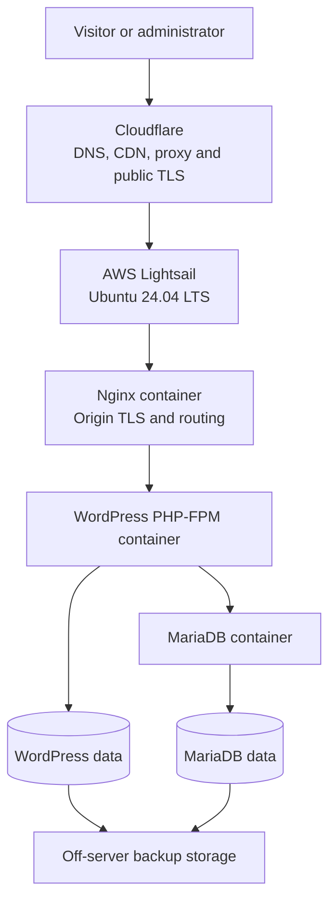
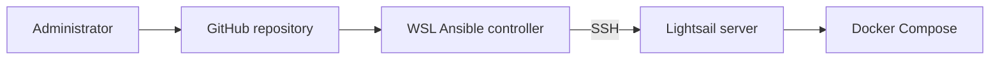

# Platform Architecture

## Purpose

The Personal Web Platform is a reproducible, container-based hosting
environment for small public web applications.

The initial workload is `chintavabna.com`. The platform is designed to
accommodate additional low-traffic applications later without coupling
the server configuration to one website.

## Target runtime architecture

## Provisioning workflow

## Responsibility boundaries

| Component | Responsibility |
|---|---|
| Cloudflare | Authoritative DNS, public TLS, proxying, caching and edge security |
| Lightsail firewall | AWS network-level ingress control |
| UFW | Host-level ingress policy and SSH rate limiting |
| Ansible | Reproducible host configuration |
| Docker Compose | Application-container lifecycle |
| Nginx | Origin TLS, virtual hosts, static files and FastCGI routing |
| WordPress/PHP-FPM | WordPress application execution |
| MariaDB | Persistent WordPress relational data |
| Named volumes | Persistent application and database storage |
| Backup system | Recovery copies stored independently of the VPS |

## Current deployment state

Production traffic still reaches the old server through Cloudflare.

The new server is not yet a production origin. It currently contains only
the secured Ubuntu host baseline. Docker and the application stack have
not yet been installed.

## Network exposure

The initial host permits:

- TCP 22 for rate-limited SSH
- TCP 80 for pre-cutover HTTP testing
- TCP 443 for pre-cutover HTTPS testing

MariaDB will not be exposed on a host or public port.

After production verification, HTTP and HTTPS origin access will be
restricted to Cloudflare address ranges. SSH will remain independently
controlled.

## Persistence model

Containers are disposable. The following state must survive container
replacement:

- MariaDB database files
- WordPress content and uploads
- production environment configuration
- TLS certificate and private key
- backup and operational state

Secrets, database files, uploads and backup archives are excluded from Git.