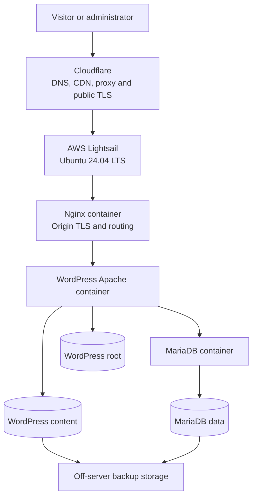

# Platform Architecture

## Purpose

The Personal Web Platform is a reproducible, container-based hosting
environment for small public web applications.

The initial workload is `chintavabna.com`. The platform is designed to
accommodate additional low-traffic applications later without coupling
the server configuration to one website.

## Target runtime architecture

## Provisioning workflow

## Responsibility boundaries

| Component | Responsibility |
|---|---|
| Cloudflare | Authoritative DNS, public TLS, proxying, caching and edge security |
| Lightsail firewall | AWS network-level ingress control |
| UFW | Host-level ingress policy and SSH rate limiting |
| Ansible | Reproducible host configuration |
| Docker Compose | Application-container lifecycle |
| Nginx | Reverse proxy, origin TLS and virtual-host routing |
| WordPress/Apache | WordPress, PHP and application HTTP handling |
| MariaDB | Persistent WordPress relational data |
| Named volumes | Persistent application and database storage |
| Backup system | Recovery copies stored independently of the VPS |

## Current deployment state

Production traffic still reaches the old server through Cloudflare.

The new server contains the migrated production WordPress database and
content. Nginx, WordPress Apache and MariaDB are running under Docker Compose.
The migrated site has passed pre-DNS HTTPS testing, but the new server is not
yet the public production origin.

Nginx now terminates HTTPS using a Cloudflare Origin CA certificate covering
`chintavabna.com` and `*.chintavabna.com`. The certificate and private key are
stored outside Git and mounted read-only into the Nginx container. External
pre-DNS testing has verified the certificate chain, hostname coverage, HTTP
redirect and HTTPS health endpoint.

## Network exposure

The initial host permits:

- TCP 22 for rate-limited SSH
- TCP 80 for pre-cutover HTTP testing
- TCP 443 for pre-cutover HTTPS testing

MariaDB will not be exposed on a host or public port.

After production verification, HTTP and HTTPS origin access will be
restricted to Cloudflare address ranges. SSH will remain independently
controlled.

## Persistence model

Containers are disposable. The following named volumes preserve application
state:

- `wordpress_root` for the WordPress document root, generated configuration,
  `.htaccess` and root-level generated files
- `wordpress_data` for plugins, themes, uploads and other `wp-content`
- `mariadb_data` for MariaDB database files

The separate WordPress root and content mounts make all persistent application
storage explicit while allowing `wp-content` to be backed up independently.

Production environment configuration and TLS material remain on the host
outside Git. Database files, uploads, secrets and backup archives are also
excluded from Git.